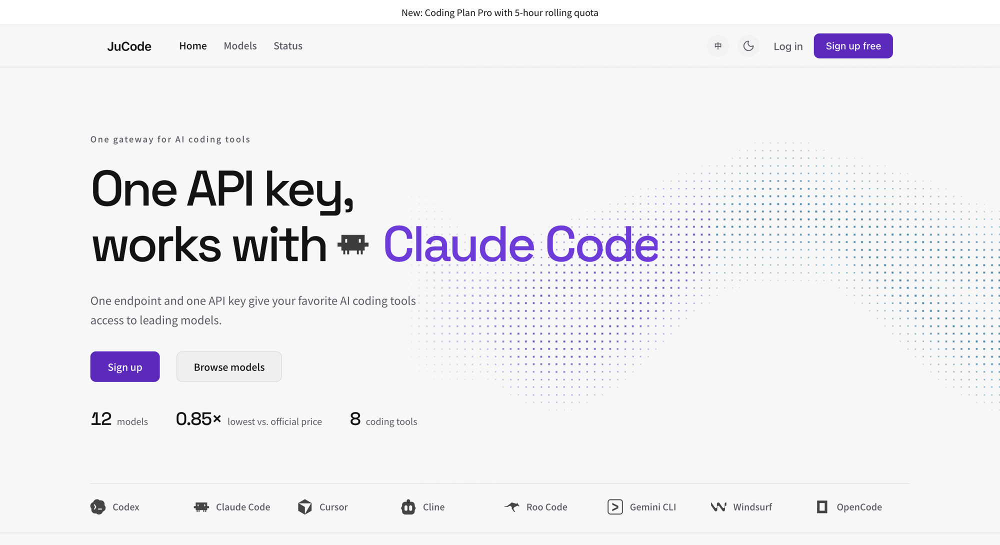
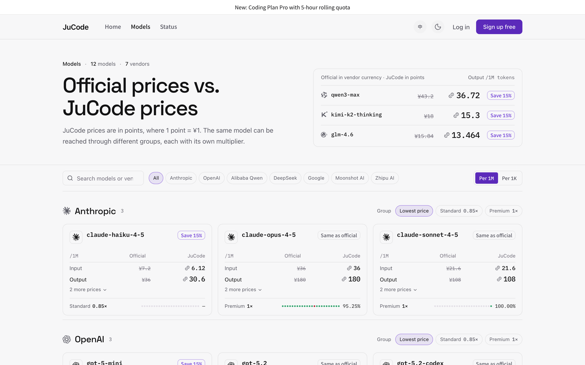
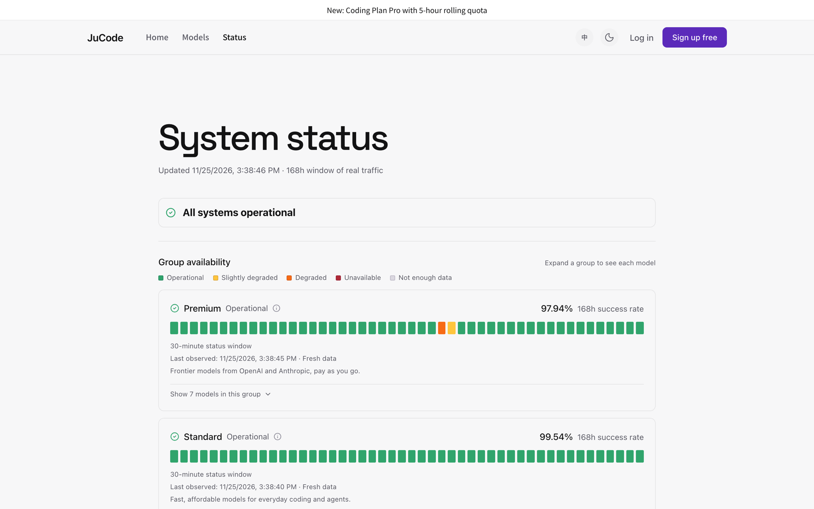
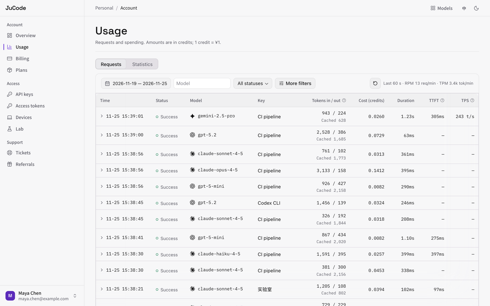
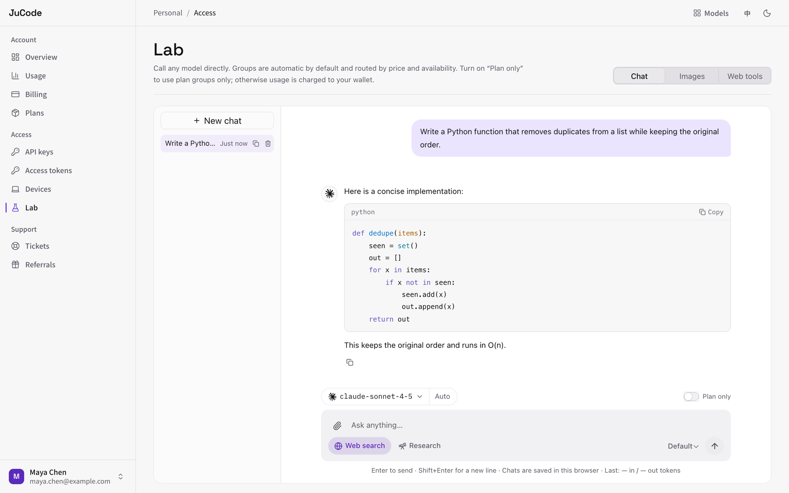
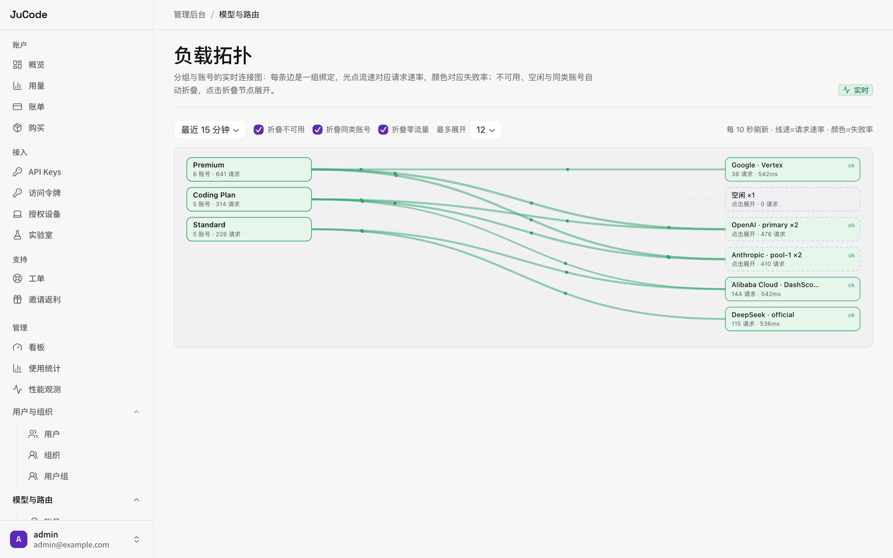
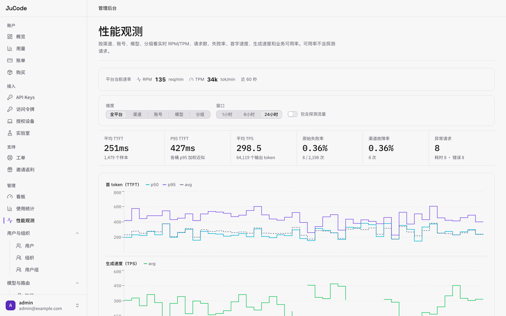
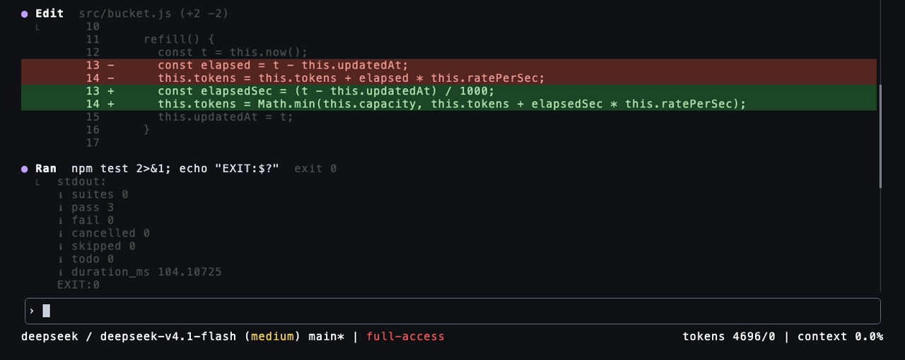

<div align="center">

# JuCode

A self-hostable LLM gateway for coding agents, with its web console and a terminal coding agent.

English | [中文](README.zh-CN.md)

</div>



JuCode gives coding tools such as Codex, Claude Code and Cursor one base URL
for the OpenAI Chat Completions, OpenAI Responses and Anthropic Messages
protocols. Behind that URL it routes each request across your own upstream
API keys, fails over when an account is unhealthy, and meters and bills every
call.

| Directory | Component | Stack |
| --- | --- | --- |
| [`backend/`](backend) | API gateway and console backend | Go, PostgreSQL, Redis |
| [`web/`](web) | Public site, user console and admin console | React, TypeScript, Vite |
| [`cli/`](cli) | Terminal coding agent (`jucode`) | Rust |

Each directory builds on its own and has its own README.

## Features

**Gateway**
- Chat Completions, Responses (HTTP and WebSocket) and Anthropic Messages,
  plus embeddings, images, audio, rerank and async video.
- Requests pass through natively when the upstream speaks the client's
  protocol, and can be converted between the three protocols when it does not.
- Upstream accounts for OpenAI, Anthropic, Azure OpenAI, Gemini, DashScope,
  Volcengine Ark and any OpenAI-compatible vendor.
- Routing by priority, weight, health, per-account concurrency and
  conversation stickiness, with failover across accounts and groups.

**Billing and users**
- Per-token and per-request prices, including cache read and write prices.
- Balances, quota plans with rolling windows, credit packs, redeem codes and
  organizations with shared balances.
- API keys restricted by model group and IP; TOTP and personal access tokens.

**Operations**
- Public status page built from real traffic and synthetic probes, with
  incidents and SLA tracking.
- Live routing topology, latency and throughput charts, and request logs.
- Per-user rate limits, alert webhooks and Prometheus metrics.

**CLI**
- Interactive TUI and a headless JSONL mode for scripts and CI.
- Diff-style edit tools, parallel read-only tools, subagents and MCP.
- Approval modes from fully manual to full access, and real token accounting.

## Screenshots

<table>
  <tr>
    <td width="50%"><br><sub>Model catalog with official and site prices</sub></td>
    <td width="50%"><br><sub>Public status page</sub></td>
  </tr>
  <tr>
    <td width="50%"><br><sub>Request log in the user console</sub></td>
    <td width="50%"><br><sub>Lab: call any model from the browser</sub></td>
  </tr>
  <tr>
    <td width="50%"><br><sub>Admin: live routing between groups and upstream accounts</sub></td>
    <td width="50%"><br><sub>Admin: latency, throughput and error rates</sub></td>
  </tr>
</table>

Most admin pages are in Chinese only; the public site and the user console
are available in English and Chinese.

### Terminal agent



## Quick start

Requires Docker with Compose.

```bash
git clone https://github.com/JuCode-Team/JuCode.git
cd JuCode
cp backend/configs/config.example.yaml backend/configs/config.yaml
docker compose up --build -d
```

This starts Postgres, Redis, the backend and the console. Open
<http://localhost:8080> and register an account, then make it an
administrator:

```bash
docker compose exec postgres psql -U jucode -c \
  "UPDATE users SET role = 'admin' WHERE email = 'you@example.com';"
```

In the admin console, add an upstream account (base URL, protocols and API
key), create a model group, bind the account and the models to it, and
create an API key. Clients then use `http://localhost:8080` as the base URL
with `Authorization: Bearer <api key>`.

The compose file sets development placeholders for `JUCODE_JWT_SECRET` and
`JUCODE_ENCRYPT_KEY`. Replace them (`openssl rand -hex 32`) before exposing
the server to anyone else.

## Using the CLI

Install a release build:

```bash
npm install -g @jucode/cli
jucode
```

Inside the TUI, `/login <provider> <api-key>` uses a provider directly, and
`/login http://localhost:8080` signs in to your own JuCode server. See
[cli/README.md](cli/README.md) for configuration, approval modes and the
daemon.

## Development

| Component | Run | Check |
| --- | --- | --- |
| backend | `go run ./cmd/jucode --config configs/config.yaml` | `make check` |
| web | `npm install && npm run dev` | `npm run typecheck && npm run lint && npm test` |
| cli | `cargo run` | `cargo clippy --workspace --all-targets && cargo test --workspace` |

Run each command inside its directory. `docker compose up -d postgres redis`
starts only the databases, on `127.0.0.1:5432` and `127.0.0.1:6379`.

## License

Apache License 2.0; see [LICENSE](LICENSE) and [NOTICE](NOTICE).
