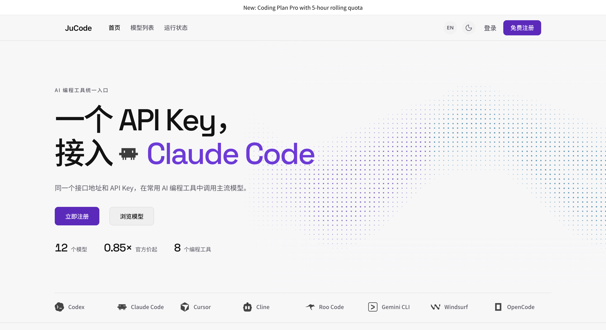
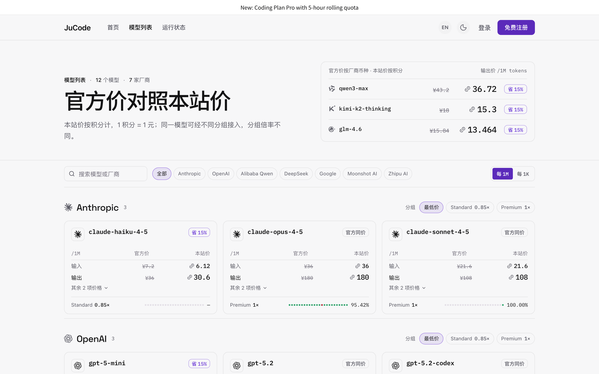
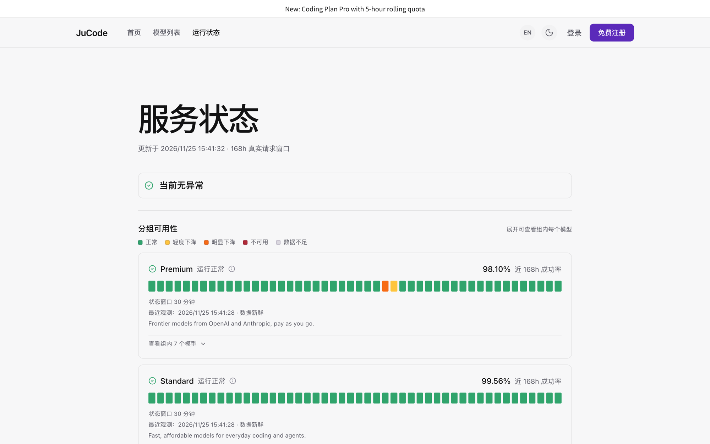
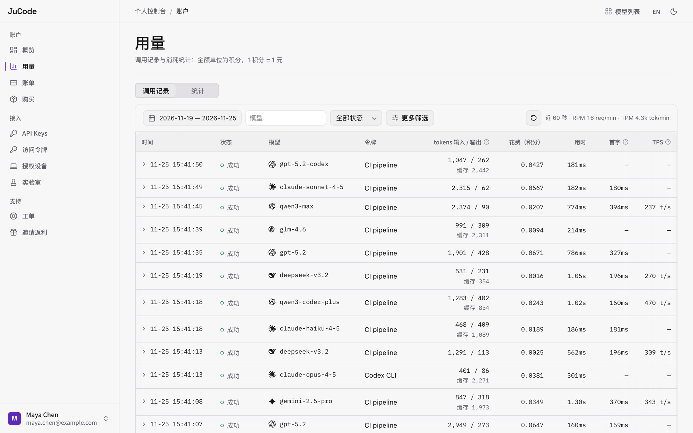
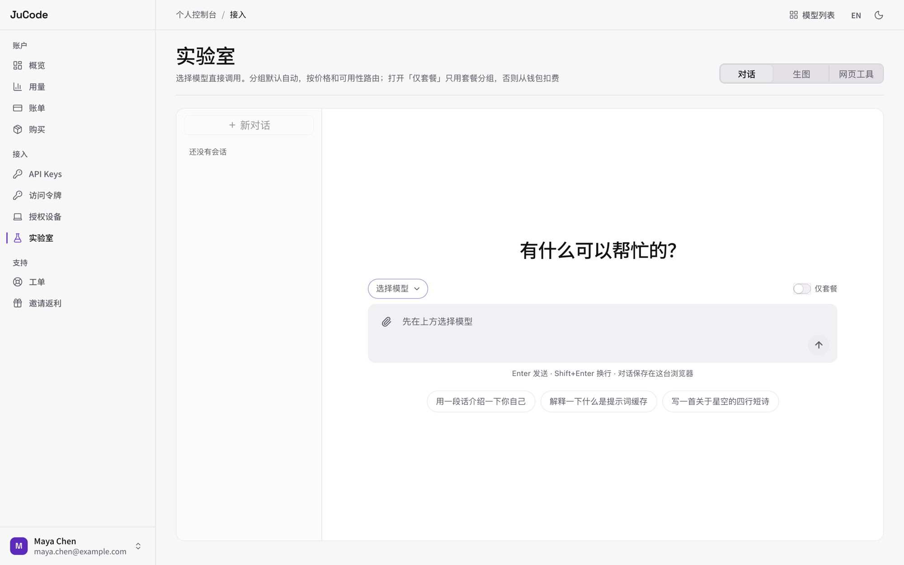
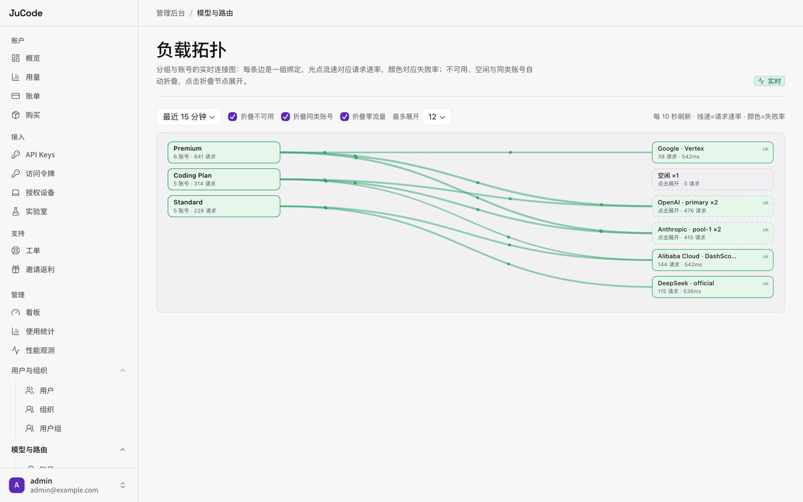
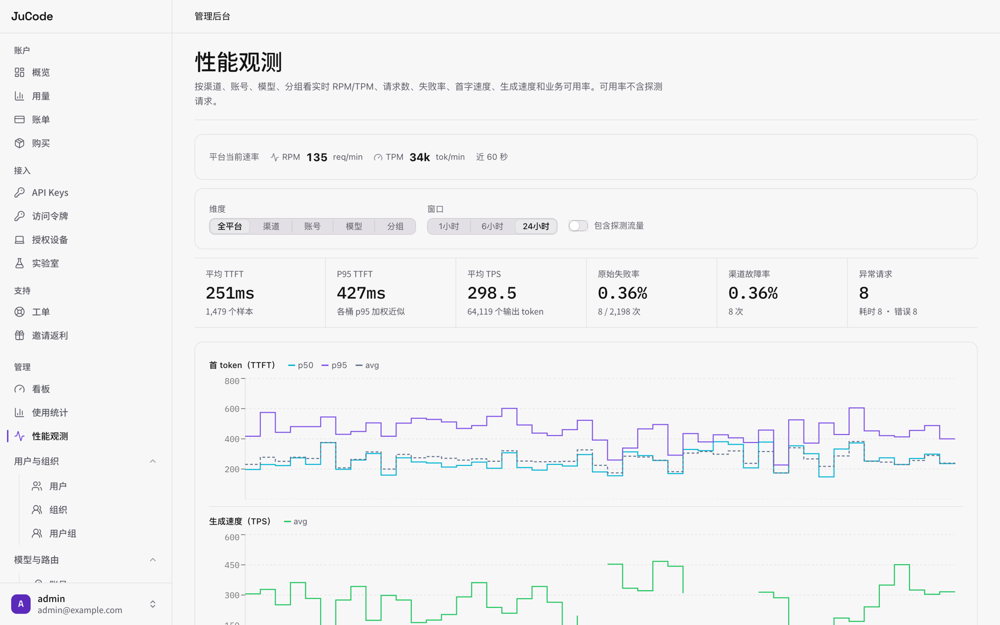
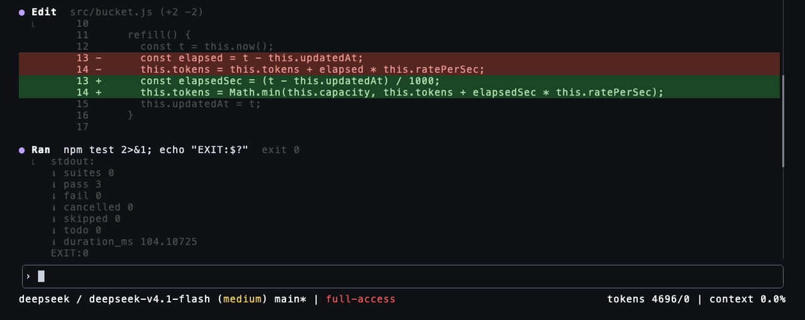

<div align="center">

# JuCode

可自行部署的大模型网关，面向编程智能体，附带网页控制台和终端编程智能体。

[English](README.md) | 中文

</div>



JuCode 为 Codex、Claude Code、Cursor 等编程工具提供一个 Base URL，支持 OpenAI Chat Completions、OpenAI Responses 和 Anthropic Messages 三种协议。网关把每个请求分配到你自己的上游 API Key。账号异常时自动切换，每次调用都会计量和计费。

| 目录 | 组件 | 技术栈 |
| --- | --- | --- |
| [`backend/`](backend) | API 网关和控制台后端 | Go、PostgreSQL、Redis |
| [`web/`](web) | 公开站点、用户控制台和管理后台 | React、TypeScript、Vite |
| [`cli/`](cli) | 终端编程智能体（`jucode`） | Rust |

每个目录可以单独构建，详细说明见各自的 README。

## 功能

**网关**
- 支持 Chat Completions、Responses（HTTP 和 WebSocket）和 Anthropic Messages，以及向量、图像、音频、重排序和异步视频接口。
- 上游与客户端协议相同时原样转发，不同时在三种协议之间转换。
- 上游账号支持 OpenAI、Anthropic、Azure OpenAI、Gemini、通义（DashScope）、火山方舟和任意 OpenAI 兼容服务。
- 按优先级、权重、健康状态、单账号并发和会话粘性路由，可跨账号、跨分组故障转移。

**计费与用户**
- 按 token 或按次计价，支持缓存读写单独定价。
- 余额、滚动窗口额度的套餐、加油包、兑换码，以及共享余额的组织。
- API Key 可限定模型分组和 IP；支持 TOTP 和个人访问令牌。

**运维**
- 公开状态页，数据来自真实流量和主动探测，记录故障和 SLA。
- 实时路由拓扑、延迟与吞吐图表、请求日志。
- 按用户限流、告警 Webhook、Prometheus 指标。

**CLI**
- 交互式 TUI，以及供脚本和 CI 使用的无界面 JSONL 模式。
- diff 形式的编辑工具、并行只读工具、子智能体和 MCP。
- 从全手动到完全放权的多级审批模式，按真实 token 统计用量。

## 截图

<table>
  <tr>
    <td width="50%"><br><sub>模型目录，对比官方价格和站点价格</sub></td>
    <td width="50%"><br><sub>公开状态页</sub></td>
  </tr>
  <tr>
    <td width="50%"><br><sub>用户控制台的请求日志</sub></td>
    <td width="50%"><br><sub>实验室：在浏览器里直接调用模型</sub></td>
  </tr>
  <tr>
    <td width="50%"><br><sub>管理后台：分组与上游账号的实时路由</sub></td>
    <td width="50%"><br><sub>管理后台：延迟、吞吐和失败率</sub></td>
  </tr>
</table>

### 终端智能体



## 快速开始

需要安装 Docker 和 Compose。

```bash
git clone https://github.com/JuCode-Team/JuCode.git
cd JuCode
cp backend/configs/config.example.yaml backend/configs/config.yaml
docker compose up --build -d
```

以上命令会启动 Postgres、Redis、后端和控制台。打开 <http://localhost:8080> 注册账号，再把该账号设为管理员：

```bash
docker compose exec postgres psql -U jucode -c \
  "UPDATE users SET role = 'admin' WHERE email = 'you@example.com';"
```

然后在管理后台依次操作：

1. 添加上游账号，填写 Base URL、协议和 API Key；
2. 创建模型分组；
3. 把账号和模型绑定到分组；
4. 创建一个 API Key。

客户端以 `http://localhost:8080` 为 Base URL，请求头带 `Authorization: Bearer <api key>`。

Compose 文件里的 `JUCODE_JWT_SECRET` 和 `JUCODE_ENCRYPT_KEY` 是开发用的占位值。服务开放给他人使用前，必须用 `openssl rand -hex 32` 生成新值替换。

## 使用 CLI

安装发布版：

```bash
npm install -g @jucode/cli
jucode
```

在 TUI 中，`/login <provider> <api-key>` 直接使用某个模型服务商，`/login http://localhost:8080` 登录你自己部署的 JuCode 服务器。配置、审批模式和守护进程的说明见 [cli/README.md](cli/README.md)。

## 开发

| 组件 | 运行 | 检查 |
| --- | --- | --- |
| backend | `go run ./cmd/jucode --config configs/config.yaml` | `make check` |
| web | `npm install && npm run dev` | `npm run typecheck && npm run lint && npm test` |
| cli | `cargo run` | `cargo clippy --workspace --all-targets && cargo test --workspace` |

以上命令在对应目录内执行。`docker compose up -d postgres redis` 只启动数据库，监听 `127.0.0.1:5432` 和 `127.0.0.1:6379`。

## 许可证

Apache License 2.0，见 [LICENSE](LICENSE) 和 [NOTICE](NOTICE)。
